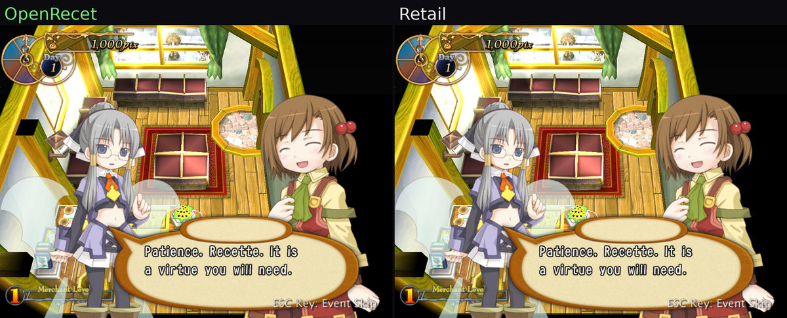
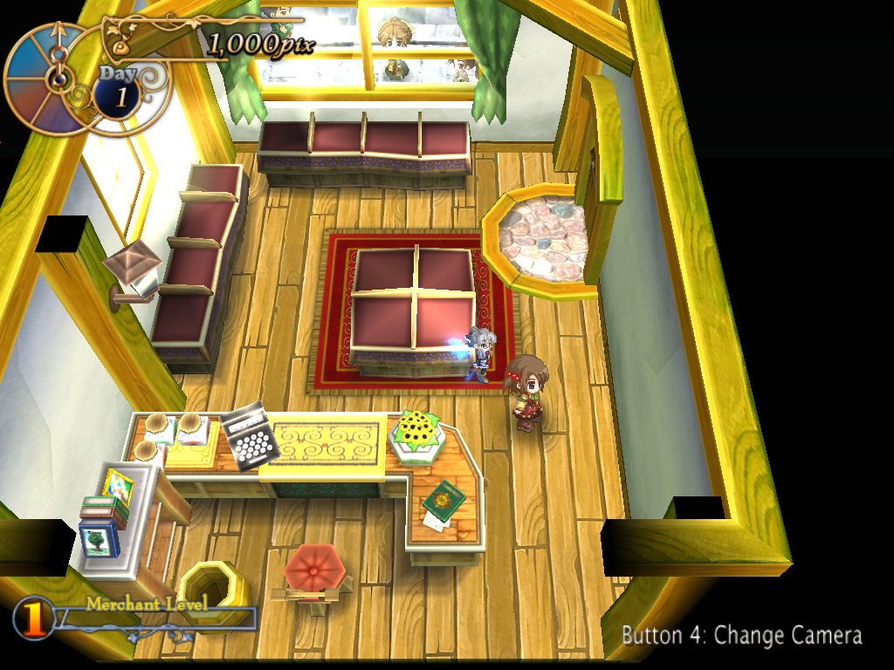
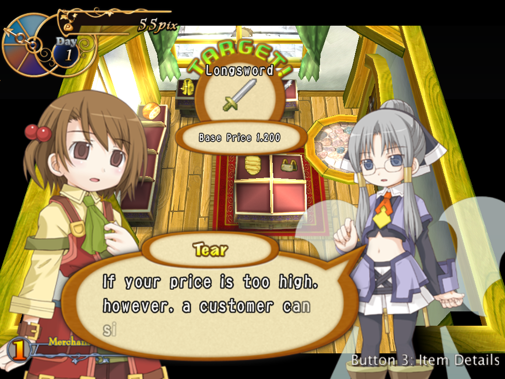

# OpenRecet

An open-source, clean-room-style C reimplementation of the Win32 engine
("Azumanga") behind **Recettear: An Item Shop's Tale** (EasyGameStation,
2007 / Carpe Fulgur EN, 2010) — aiming at a drop-in replacement for
`recettear.exe` that behaves like the original for people who own a
legitimate copy of the game.

This is an **educational reverse-engineering and game-preservation
project**. It ships **no game assets, no decompiled binary, and no
copyrighted content** — you bring your own copy of the game. MIT licensed
(our code only; no rights to the original game are granted).



*OpenRecet on an opening-prologue iv1_2 dialogue line: the dialogue box and
nameplate, both character standees, the spell-circle effect, and the top HUD
(clock / day / money) the engine draws over the live map — with the townsfolk
drifting past the back window. Every shot below is a real OpenRecet frame,
verified bit-for-bit against the original engine on the same deterministic input
trace (we no longer print them side by side — on the beats we showcase, the port
matches retail 1:1).*

More OpenRecet captures from the same deterministic traces:



*Free-roaming in the shop: the 3D room (geometry, textures, lighting, window
god-rays), the persistent top HUD (clock / day / money), the "Change Camera"
hint, Recette, and a townsperson drifting past the back window.*



*Haggling with a customer over a sale: the "Bargain!" price gauge, the item's
base price, the customer's reaction, and the item-details hint — the
customer-service negotiation UI rendered over the live shop.*

In memory of Andrew Dice / [@SpaceDrakeCF](https://x.com/SpaceDrakeCF)
and Carpe Fulgur.

## Status — playable, unfinished

The port boots, plays and saves through the whole game: from the opening
prologue, the shop days and the dungeons through the ending, New Game+ and the
Survival modes. It is **not finished**. Many functions are still stubs or
shortcuts (tagged `PORT-DEBT` in the source, listed in
[`docs/port-debt.md`](docs/port-debt.md)), and only the paths a recording has
reached are checked against the original. Expect bugs off those paths. Rendering
and audio are checked less than game logic.

Where things stand:

- **[`docs/FRONT.md`](docs/FRONT.md)**: the open work and the latest results.
- **[`docs/PROGRESS.md`](docs/PROGRESS.md)**: dated changelog.
- **[`docs/STATUS.md`](docs/STATUS.md)** and
  **[`docs/port-ledger.md`](docs/port-ledger.md)**: per-function inventory,
  generated from the source. It counts source markers only, not proof that a
  function matches retail.

**[Recettear Agent Runs](https://claude.ai/artifact/DtZTrpxVmeBmEQ97eDEtBG)**
has videos and notes from the AI agents that play the original game to make
the test recordings: boss fights, mob floors and 100 dungeon floors, each one
replayed by the port to the same state.

## How it's verified

The original game is the reference. It runs **inside our own test host**
(`tools/rhost/`) with its clock, heap, file access, input and loaders pinned,
so the same save and input recording always gives the same game state, byte
for byte. It runs on Windows, or headless under wine. Then the port replays
the same recording, and the two must match:

- **every tick**: random-number draws and game-state fields, frame for frame;
- **at the end**: the `save.dat` the port writes must be byte-identical to
  retail's.

Recordings come from two places: people playing the game, and AI agents that
drive the original game with a small command-line tool (`./rd`, see
[`tools/drive/README.md`](tools/drive/README.md)). An agent's run is an input
movie that a fresh retail process replays to the same state. That lets agents
cover things nobody has recorded yet, such as boss fights, rare menus and late
dungeon floors. When the port splits from retail, the first frame where it
differs points at the function to fix. Each fix is committed with its evidence.

Today the gate suite is **153 checks over 106 scenarios** (tick-identical runs
and byte-identical saves), and every one has to stay green. Other tools:

- Direct3D 8 command-stream capture and replay for visual checks;
- a host unit suite for decoders and game logic, run under
  AddressSanitizer + UndefinedBehaviorSanitizer.

Background: the methodology decision record
[`docs/audits/2026-10-13-methodology-reset.md`](docs/audits/2026-10-13-methodology-reset.md),
the test host [`tools/rhost/README.md`](tools/rhost/README.md), and delegation
conventions [`docs/AGENT-WORKFLOW.md`](docs/AGENT-WORKFLOW.md).

## Building & running

You need **your own legitimately-owned copy of Recettear** — the build
ships no assets, and on first run the port reads the game's sound effects
out of your own retail `recettear.exe` and caches them locally (it never
redistributes them; see [`docs/formats/se-pack.md`](docs/formats/se-pack.md)).

```sh
nix develop            # dev shell: mingw-w64 32-bit cross compiler + RE toolchain
make -C src            # cross-compiles build/openrecet.exe (+ openrecet-debug.exe)
make -C tests run      # the host unit-test suite
```

Place the resulting `openrecet.exe` in your Recettear install folder
(alongside `recettear.exe`, which it reads SE from) and run it. The exact
reference binary all of this targets is documented in
[`docs/reference/vendor-exe.md`](docs/reference/vendor-exe.md).

**Pre-built:** a fresh build goes up at least once a day as the rolling
[`nightly`](https://github.com/Francesco149/openrecet/releases/tag/nightly)
pre-release. Download `openrecet.exe`, drop it into your Recettear folder and
run it. It is unsigned and needs your own copy of the game.

## Repository layout

```
docs/     design notes, file-format specs, RE findings, status pages
src/      the C reimplementation (cross-compiled with mingw32)
tests/    host unit tests, golden-frame diffs, format-decoder tests
tools/    test host (rhost), agent driver (rd), extractors, CI scripts
```

## Support & how this is made

This project's reverse-engineering, implementation, and documentation are
**AI-assisted and maintainer-directed**. Different reasoning systems may be used for
architecture, implementation, searches, and verification; the repository records
evidence and reasoning tiers rather than presenting one model name as permanent
provenance. The methodology is intended to be reproducible and auditable.

If you'd like to support the work: **[ko-fi.com/lolisamurai](https://ko-fi.com/lolisamurai)**.
Donations go toward the AI compute that does the work — roughly **€240 ≈
one month of intense RE**, spread across a few projects in parallel to use
the subscription efficiently. **Games suggested in donations will be
considered as future RE targets.**

## Legal

OpenRecet is an independent, unofficial project and is **not affiliated
with or endorsed by EasyGameStation or Carpe Fulgur**. It contains none
of the original game's assets or code and requires you to own a legitimate
copy of Recettear (Steam App ID 70400). All trademarks belong to their
respective owners. OpenRecet's own source is released under the
[MIT license](LICENSE).
</content>
